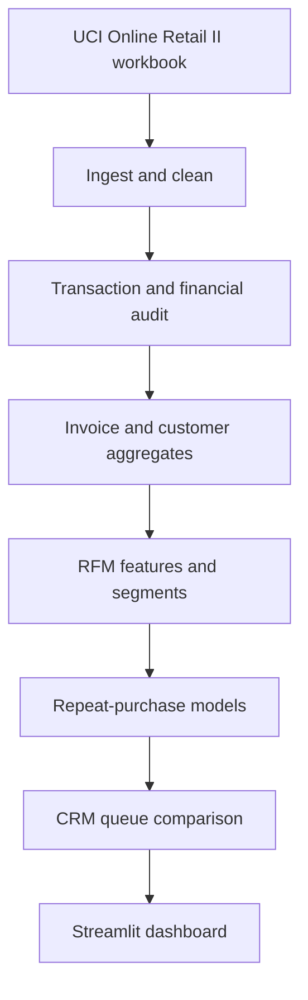

# RetenSight

RetenSight is a small CRM decision-support project for an online retailer. It uses historical transactions to group customers, estimate who is likely to buy again, and compare ways to prioritize customer outreach.

**Dashboard:** https://retensight.streamlit.app/  
**Source data:** UCI Online Retail II, covering December 2009 to December 2011.

## What it does

1. **Cleans transaction data.** It checks the workbook, removes verified copies duplicated between the two sheets, classifies transactions, and reconciles financial totals.
2. **Builds customer profiles.** It calculates Recency, Frequency and Monetary value (RFM) and assigns each eligible customer to a CRM segment.
3. **Estimates repeat-purchase likelihood.** It compares a simple RFM logistic-regression model with a model using additional historical features.
4. **Compares contact strategies.** It tests Risk-first, Value-aware and Hybrid queues at fixed contact capacities against a random-selection benchmark.
5. **Presents the findings.** The Streamlit dashboard has three views: Overview, Customer segments and Contact strategy.

## What the analysis found

- The cleaned workbook contains **1,044,848 transaction rows** and **53,628 unique invoices**.
- The customer-level analysis covers **5,942 customers** across the full history.
- The primary observed model-comparison cohort contains **4,952 customers**. **32.03%** made a qualifying purchase in the following 90 days.
- At 10% contact capacity, the RFM Risk-first queue had **94.95% non-repeat precision**, compared with about **67.98% expected from random selection**.
- The expanded model adds only small practical gains over the simpler RFM model, so RFM remains the recommended default.

These are results from historical data, not proof that a campaign would change customer behaviour. The December 2011 snapshot has no fully observed future 90-day outcome.

## How the analysis fits together



## Run the project

Use Python 3.10 or newer.

1. Download the UCI Online Retail II workbook and place it at `data/raw/online_retail_II.xlsx`. The raw workbook is not stored in this repository.
2. Install the dependencies:

   ```bash
   pip install -r requirements.txt
   ```

3. Run ingestion, cleaning, audits, invoice aggregation and RFM outputs:

   ```bash
   python -m retensight.pipeline
   ```

4. Run the repeat-purchase modelling step after the pipeline creates the RFM snapshots:

   ```bash
   python -m retensight.modeling
   ```

5. Run the fast tests:

   ```bash
   python -m pytest -m "not full_data"
   ```

6. Start the dashboard:

   ```bash
   streamlit run streamlit_app.py
   ```

The dashboard reads the committed aggregate reports in `reports/`; it does not need the raw workbook to run.

## Project map

| Path | What it contains |
|---|---|
| `retensight/` | Ingestion, cleaning, aggregation, audit, RFM and modelling code |
| `tests/` | Unit and integrity tests |
| `docs/` | Data definitions and method notes |
| `reports/` | Generated summaries, evaluation results and machine-readable outputs |
| `streamlit_app.py` | Interactive dashboard |

## Important definitions

- **Qualifying purchase:** A customer-attributed invoice with positive merchandise sales that is not a cancellation or bad-debt adjustment.
- **Repeat purchase:** At least one qualifying purchase in the 90 days after the scoring date.
- **Customer commercial spend:** Historical customer-attributed commercial value, excluding administrative settlements and bad-debt adjustments.
- **Queue spend:** Historical spend linked to the selected customers. It is not profit, customer lifetime value, or revenue saved.

## Further reading

- [Cleaning rules](docs/cleaning_rules.md)
- [Data dictionary](docs/data_dictionary.md)
- [RFM features and segmentation](docs/rfm_feature_definitions.md)
- [Special stock-code audit](docs/special_stock_code_audit.md)
- [Cleaning and reconciliation results](reports/cleaning_and_reconciliation_summary.md)
- [RFM summary](reports/rfm_segmentation_summary.md)
- [Model evaluation](reports/repeat_purchase_model_evaluation.md)
- [Special stock-code results](reports/special_stock_codes_audit.md)

The project uses the UCI Online Retail II dataset. The RFM approach and logistic regression are established methods; this project focuses on implementing them carefully and making the resulting CRM trade-offs clear.
