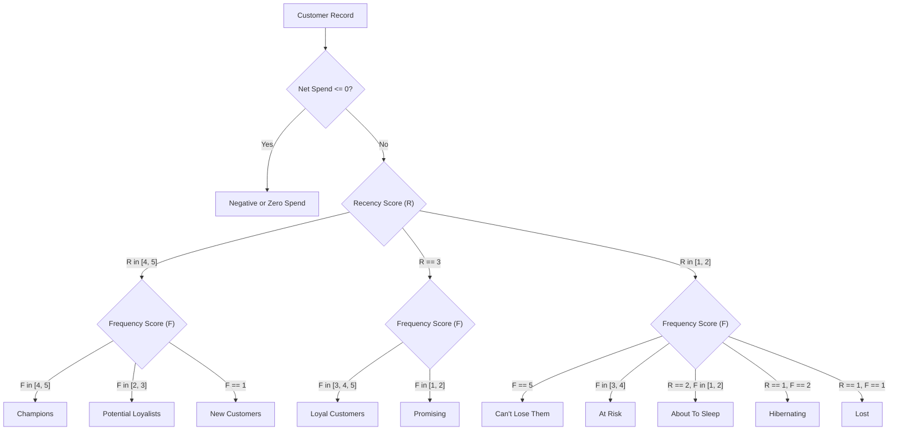

# RetenSight — Customer RFM Feature Definitions & Segmentation Methodology

## 1. Overview & Objectives

Customer repeat purchase and relationship management (CRM) requires robust, leakage-safe historical feature representations. This document establishes the exact mathematical formulas, data grain aggregations, tie-breaking rules, and business segment definitions implemented in RetenSight.

---

## 2. Qualifying Purchase Event Definition

To prevent non-product administrative fees (such as shipping surcharges or ledger adjustments) and cancellations from artificially inflating customer purchase frequency, qualifying purchase events are defined strictly at the **invoice grain**:

An invoice $i$ qualifies as a purchase event if and only if all of the following criteria hold:
1. **Valid Customer Attribution:** $\text{customer\_id}_i \text{ is not NULL}$.
2. **Temporal Validity:** $\text{invoice\_date}_i \le T_{\text{snapshot}}$.
3. **Non-Cancellation:** $\text{is\_cancellation}_i = \text{False}$ (invoice number does not start with `'C'`).
4. **Non-Bad-Debt:** $\text{is\_bad\_debt}_i = \text{False}$ (invoice number does not start with `'A'`).
5. **Positive Merchandise Sales:** $\text{product\_sales}_i > 0.0$ (invoice contains at least one positive standard catalog merchandise line).
6. **Positive Net Quantity:** $\text{total\_quantity}_i > 0$.

### Handling Invariants
- **Multi-line Invoices:** Aggregation occurs at the unique invoice ID grain ($\text{nunique}(\text{invoice})$). An invoice containing 50 line items counts as exactly **1** qualifying purchase event, preventing line count from leaking into frequency.
- **Charge-Only Invoices:** Invoices containing solely postage fees (`POST`, `DOT`) or manual fees (`M`) have $\text{product\_sales} = 0.0$ and do not count as purchases.
- **Same-Day Invoices:** For customers who placed multiple orders on the same calendar day (e.g., morning and afternoon orders with distinct invoice IDs), each invoice is tracked as an independent purchase order ($\text{frequency}$). In addition, $\text{distinct\_purchase\_days}$ is recorded to reflect daily purchase cadence without multi-order bias.

---

## 3. Mathematical Feature Formulations

For an eligible customer $c$ with qualifying purchase set $\mathcal{I}_c = \{i \mid \text{qualifying}(i) \land \text{customer}(i) = c \land \text{date}(i) \le T_{\text{snapshot}}\}$:

### 3.1. Recency ($\text{Recency}$)
The whole number of days elapsed between the customer's most recent qualifying purchase and the snapshot cutoff:
$$\text{Recency}_c = \left\lfloor \frac{T_{\text{snapshot}} - \max_{i \in \mathcal{I}_c}(\text{invoice\_date}_i)}{86400 \text{ seconds}} \right\rfloor$$
- $\text{Recency}_c \ge 0$.

### 3.2. Customer Tenure ($\text{Tenure}$)
The whole number of days elapsed since the customer's very first qualifying purchase:
$$\text{Tenure}_c = \left\lfloor \frac{T_{\text{snapshot}} - \min_{i \in \mathcal{I}_c}(\text{invoice\_date}_i)}{86400 \text{ seconds}} \right\rfloor$$
- Invariant: $\text{Tenure}_c \ge \text{Recency}_c$.

### 3.3. Frequency ($\text{Frequency}$)
The total count of distinct qualifying purchase invoices up to the cutoff:
$$\text{Frequency}_c = |\mathcal{I}_c| = \text{count of distinct qualifying invoices}$$

### 3.4. Distinct Purchase Days
The count of unique calendar dates on which the customer completed at least one qualifying purchase:
$$\text{DistinctDays}_c = \text{nunique}(\text{date}(\text{invoice\_date}_i)) \quad \text{for } i \in \mathcal{I}_c$$
- Invariant: $1 \le \text{DistinctDays}_c \le \text{Frequency}_c$.

### 3.5. Component-Level Monetary Values
Calculated across all historical customer invoices $\mathcal{J}_c$ on or before $T_{\text{snapshot}}$ (including shipping charges and returns):
- **Monetary Product Sales ($\text{M}_{\text{prod}}$):** $\sum_{j \in \mathcal{J}_c} \text{product\_sales}_j$
- **Monetary Special Charges ($\text{M}_{\text{spec}}$):** $\sum_{j \in \mathcal{J}_c} \text{special\_charges}_j$ (shipping, manual entries)
- **Monetary Gross Sales ($\text{M}_{\text{gross}}$):** $\text{M}_{\text{prod}} + \text{M}_{\text{spec}}$
- **Monetary Cancellations / Returns ($\text{M}_{\text{canc}}$):** $\sum_{j \in \mathcal{J}_c} \text{cancellation\_value}_j \le 0$
- **Net Monetary Value ($\text{NetSpend}$):** $\text{M}_{\text{gross}} + \text{M}_{\text{canc}}$
- **Average Order Value ($\text{AOV}$):** $\frac{\text{NetSpend}_c}{\text{Frequency}_c}$ if $\text{NetSpend}_c > 0$, else £0.00.

---

## 4. Deterministic RFM Scoring Scheme

Scores are scaled from 1 to 5 (with 0 reserved for negative spend edge cases):

### 4.1. Recency Score ($R\_Score \in \{1, 2, 3, 4, 5\}$)
Lower recency indicates recent activity and receives higher engagement scores:
- Ranked quintiles:
  - Top 20% most recent: **5**
  - 20% – 40%: **4**
  - 40% – 60%: **3**
  - 60% – 80%: **2**
  - Bottom 20% (longest elapsed): **1**

### 4.2. Frequency Score ($F\_Score \in \{1, 2, 3, 4, 5\}$)
Because retail transaction datasets exhibit substantial mass at $F=1$ (~28–33% of customers), standard quantile binning collapses. To ensure 100% deterministic scoring and eliminate arbitrary tie-breaking:
- $F = 1 \implies \mathbf{1}$ (One-time customer)
- $F = 2 \implies \mathbf{2}$ (Repeat buyer / second order)
- $F \in \{3, 4\} \implies \mathbf{3}$ (Multi-order regular)
- $F \in \{5, 6, 7, 8\} \implies \mathbf{4}$ (Frequent buyer)
- $F \ge 9 \implies \mathbf{5}$ (High-frequency VIP buyer)

### 4.3. Monetary Score ($M\_Score \in \{0, 1, 2, 3, 4, 5\}$)
- If $\text{NetSpend}_c \le 0$: $M\_Score = \mathbf{0}$ (isolated into negative spend segment).
- For customers with positive net spend ($\text{NetSpend}_c > 0$), scores 1 to 5 are assigned via quintiles ($Q_{20}, Q_{40}, Q_{60}, Q_{80}$).

---

## 5. Explainable CRM Segmentation Scheme

Customers are mapped to 10 explainable business segments plus a dedicated negative net spend segment:

| Segment Name | Definition Criteria | Business Action & Strategy |
| :--- | :--- | :--- |
| **Champions** | $R \in [4, 5], F \in [4, 5]$ | Reward loyalty, offer early product access, VIP concierge outreach. |
| **Loyal Customers** | $R = 3, F \in [3, 4, 5]$ | Upsell higher-value lines, incentivize membership and referrals. |
| **Potential Loyalists** | $R \in [4, 5], F \in [2, 3]$ | Recommend complementary categories, offer second-tier bundle discounts. |
| **New Customers** | $R \in [4, 5], F = 1$ | Onboarding sequence, product usage support, early second-purchase incentive. |
| **Promising** | $R = 3, F \in [1, 2]$ | Re-engagement campaigns, limited-time seasonal coupons. |
| **About To Sleep** | $R = 2, F \in [1, 2]$ | Reactivation campaigns before dormancy; survey customer satisfaction. |
| **At Risk** | $R \in [1, 2], F \in [3, 4]$ | High-value win-back offers, personalized outreach, direct mail. |
| **Can't Lose Them** | $R \in [1, 2], F = 5$ | Highest priority CRM reactivation; executive outreach and bespoke renewal deals. |
| **Hibernating** | $R = 1, F = 2$ | Deep discount re-engagement or low-cost automated email workflows. |
| **Lost** | $R = 1, F = 1$ | Archive or include in broad low-frequency brand awareness campaigns. |
| **Negative or Zero Spend** | $\text{NetSpend} \le 0$ | Investigate product defect/return reasons; audit customer accounts. |

---

## 6. Evaluation Cutoffs and Forward 90-Day Target Calibration

Strict chronological evaluation cutoffs are established with observed 90-day forward windows:

| Cutoff Date | Historical Window | Forward Target Window | Eligible Customers | 90-Day Repeat Purchasers | 90-Day Repeat Rate (%) |
| :--- | :--- | :--- | ---: | ---: | ---: |
| **`2010-12-09`** | 2009-12-01 to 2010-12-09 (12 mo) | 2010-12-10 to 2011-03-10 (90 days) | 4,286 | 1,317 | **30.7%** |
| **`2011-06-10`** | 2009-12-01 to 2011-06-10 (18 mo) | 2011-06-11 to 2011-09-08 (90 days) | 4,952 | 1,586 | **32.0%** |
| **`2011-09-10`** | 2009-12-01 to 2011-09-10 (21 mo) | 2011-09-11 to 2011-12-09 (90 days) | 5,257 | 2,289 | **43.5%** |
| **`2011-12-09`** | 2009-12-01 to 2011-12-09 (24 mo) | Unobserved (Dataset End) | 5,853 | N/A | **N/A (Current CRM Snapshot)** |

All features as-of each cutoff strictly access data prior to or on the cutoff date. The forward target indicates whether the customer made $\ge 1$ qualifying product purchase during the observed 90-day post-cutoff period.
